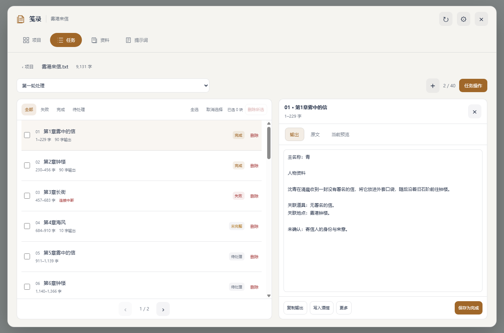

# 笺录 · 小说工作台

SillyTavern 扩展，版本 0.4.0。一部小说一个项目，使用酒馆当前的预设、世界书和 API 处理材料。

插件提供项目、原文、分块任务、流式输出、请求快照、失败重试、人物与道具资料、角色卡和世界书写入。主要处理要求和输出格式由自己的酒馆预设定义；资料操作可附加本次目标名称、背景归属、限定阶段和自检内容，不内置角色卡或道具的固定长模板。



[手机工作台](dev/ui-mobile.png) · [手机资料页](dev/ui-mobile-library.png) · [提示词编辑](dev/ui-mobile-prompts.png) · [导入目标](dev/ui-mobile-write.png)

## 安装

在酒馆的“扩展 → 安装扩展”中填写仓库地址：

```text
https://github.com/1842a-droid/ST-Jianlu
```

安装完成后刷新酒馆，在输入框旁的扩展菜单打开“笺录”。之后在 GitHub 修改源码并提交，在酒馆扩展管理中更新“笺录”，再刷新页面即可加载改动。

### 手动安装

解压安装包，把完整的 `ST-Jianlu` 文件夹放进酒馆目录：

```text
SillyTavern/
  public/scripts/extensions/third-party/ST-Jianlu/
    manifest.json
    index.js
    ...
```

也可以安装在酒馆用户目录的 `data/<用户名>/extensions/ST-Jianlu/`。选择其中一种位置即可，不要重复安装。放好后刷新酒馆，在输入框旁的扩展菜单打开“笺录”。本地 ZIP 不是 Git 仓库地址，不要把 ZIP 路径填到“安装扩展”的仓库地址框。

源码直接使用浏览器 ES modules，无须 npm install 或编译。修改 JS/CSS 后刷新酒馆即可生效。

## 使用

1. 在酒馆打开一个单角色对话，选择 **Chat Completion** API 和自己的处理预设。
2. 打开笺录，新建项目，导入 TXT/Markdown 小说或粘贴原文。
3. 新建任务，选择输入与分块方式。可以按字数设置长度与重叠，也可以按章节指定每块几章、起止章节序号。生成计划不调用模型。
4. 点击任意块，电脑直接在右侧查看、编辑输出和提示词，手机打开大详情页。原生预设、世界书仍在酒馆界面编辑；本插件的对象提示词在“提示词”页或资料卡片的“提示词”中查看与修改。
5. 点击上方“任务操作”，选择“继续剩余”或“仅重试失败”；逐块保存结果，中间某块失败不影响其他块。
6. 勾选一个或多个块，在“任务操作”中执行；删除可用列表右侧的“删除”或筛选栏的“删除所选”。“取消选择”只取消勾选。删除会确认，只移除所选块及其结果，不修改小说原文。运行中的任务需要先暂停。
7. 块详情可以编辑输出；“任务操作 → 合并导出”可导出结果。已有任务结果也能作为新任务输入，因此合并、自检和二次处理同样由预设完成。

任务下拉框切换本项目的处理记录，旁边的“＋”新建任务。“已完成 / 总块数”直接放在“任务操作”旁。主界面不显示当前任务说明行、预设、接口、世界书按钮，也没有固定底部操作栏。

## 人物、道具与输出主名称

在“资料”主页面统一管理人物、道具和设定。支持新增、修改、删除、重复名称、筛选、全选、取消选择、检索原文、关联合并、限定阶段、名称扫描、资料自检和 JSON 导入导出。新增条目默认不勾选。各项目的资料相互独立，随项目备份保存。

名称扫描完成后，在“资料操作 → 从输出或备份导入”中读取当前任务输出。多块各自返回的 JSON 数组或对象数组可以连续导入，支持 JSON 代码围栏；不完整 JSON 会提示修正，不静默漏掉失败块。

自检窗口可修改待检查内容，扫描材料可选小说检索结果或另行粘贴的文本。可直接复制、粘贴自己的内容；计划保存的是本次填写的版本，不改小说原文或已存资料。

“检索名称”“同一对象别名”和“附加检索词”用于找原文；“输出主名称”指定最终生成和新建角色卡的名字。“关联背景词”用于补充族群、道具、组织等背景，不作为同一对象别名。例如检索 abc、b、c，但输出主名称填 a，则本次只要求生成 a 的资料。合并默认把其他条目作为关联资料，只有明确选择“确认为同一对象”时才合并别名。模型仍可能误判，结果可编辑后保存。

“生成所选”按对象创建独立分块，材料可设置每处命中前后字数和总上限；填 0 不限制总量。达到上限会提示确认，不静默丢掉超出材料。各对象均可单独执行、重试和删除。本次输出格式可留空沿用酒馆预设，也可在“资料操作 → 输出格式”保存项目自己的格式。生成计划和检索不会调用模型；名称扫描也是先建任务，执行时才调用当前接口。

块详情直接有“写入酒馆”，“更多”中有“保存到资料”；合并结果和资料卡片也提供对应入口。导入到角色卡、已有世界书、新建世界书分开选择，目标可以搜索。角色卡按头像文件标识定位，同名卡显示不同编号；可选择字段追加或替换，也可明确选择新建角色卡。世界书名称与条目名称分开，不会把新建书名当成对象名。导入失败时保留表单与错误信息；成功后即使其他扩展的刷新事件报错，也明确提示内容已保存。资料列表支持批量写入、角色卡 V2 JSON 和世界书 JSON 导出。插件不会执行导入角色卡携带的脚本。

## 对象提示词

“提示词”页分别查看、编辑人物、道具、设定、自检和名称扫描的提示词。每张资料卡片的“提示词”按钮还可为单个对象覆盖，并查看替换名称、阶段等数据后的对象要求。“查看完整请求”通过当前酒馆预设准备预览，不发起模型生成；实际请求仍以执行后的块详情为准。

支持插入 `{{name}}`、`{{search_name}}`、`{{aliases}}`、`{{context_terms}}`、`{{stage}}`、`{{notes}}`、`{{existing}}`。修改保存为当前项目配置，不修改酒馆原生预设。项目模板与单对象覆盖都会随备份保存。更改用于之后新建的资料任务；已有任务继续保留创建时的对象要求与请求快照。

## 流式输出与中断保存

运行时“输出预览”和当前块详情会随收到的 SSE 内容更新，不等待整块结束。内存预览约每 100 ms 更新一次，服务器检查点约每 1.5 秒保存一次；最终状态另行保存。暂停、断线和输出上限保留已收到文字，重试前的旧输出也保留在详情中。刷新后以最后成功写入服务器的检查点恢复，无法保证保存尚未落盘的最后一小段。

流式请求使用酒馆原生请求参数构建器和同源后台接口，不修改酒馆全局流式开关。模型、代理和服务端本身需要支持流式；缺少原生参数构建器的旧版酒馆会退回完整响应，建议更新酒馆。没有伪造逐字动画。

## 分块与模型

按章节模式识别紧邻正文标题的“第998章紫剑的来由”、中文数字、英文 Chapter 和常见卷篇标题。章节序号是本次原文中识别出的顺序，从 1 开始；首个标题前的序言随第一章保留。每章完整保留，不按字数暗中切开，也不添加重叠。未找到标题时明确提示改用按字数。已有任务的分块保持原状，切换方式请新建任务。

“设置 → 接口与模型”显示当前接口的真实模型选项，应用后通过酒馆原生控件更改并保存当前模型。自定义接口还可手填模型 ID；需要更改 URL、密钥或加载模型列表时，使用其中的“编辑接口连接”。准备或生成期间先暂停，再切换模型。

原文文件支持 UTF-8、带 BOM 的 UTF-16 和 GB18030。插件不设固定字数上限，实际容量取决于浏览器内存、酒馆服务器和模型上下文。超过 20 万字的整体原文/合并内容只显示前 20 万字预览，保存、处理、复制和导出使用完整文本。

## 预设与世界书

使用酒馆原生 Chat Completion 的 Prompt Manager 构建请求，沿用已启用条目的顺序、身份、插入位置和深度，并使用当前角色绑定及全局选择的世界书。扫描材料是当前原文块。新建任务可填写本次要求，人物资料任务还会附加所选对象的身份边界；这些内容会记录在该块实际请求中。

通常只需保留预设的 **Chat History** 条目：插件把当前块作为一条独立输入放在这个位置，不带入已有聊天记录，也不向聊天插入小说和处理结果。

如需自定原文位置，可在启用的预设/世界书条目内使用数据占位符：

| 占位符 | 内容 |
| --- | --- |
| `{{jl_source}}` | 当前完整输入块 |
| `{{jl_project}}` | 小说项目名称 |
| `{{jl_block}}` | 当前块的章节或片段标签 |
| `{{jl_index}}` | 当前块序号，从 1 开始 |
| `{{jl_total}}` | 本次任务总块数 |

这些占位符只填入数据，不添加处理指令。若原文因为 Chat History 被关闭、插槽缺失或上下文容量不足而未完整进入请求，任务会明确报错，避免发送缺失材料。

待处理的新块在执行前读取当前预设；修改预设后，后续块使用修改后的配置。已运行块保留原请求，普通重试使用其原提示词；“按当前预设重跑”会重新读取配置，保留上一版输出。重试时若 API/模型/连接地址与记录不同，会提示切回或重新准备该块，不会暗中改写酒馆连接。

提示词页区分“当前预览”和“实际请求”。实际记录标明捕获阶段；宿主后端仍可能按提供商要求转换消息格式。复杂第三方 EJS、酒馆助手脚本、变量框架和其他扩展的所有行为不属于首版的完整兼容承诺。

## 结果与恢复

- 输出按任意文本保存，不强制人物、道具、剧情等数据结构。
- 完成一块保存一块；普通继续会跳过完成块与失败块。
- 重试失败不会重做已完成块；有意重做完成块需要在详情中确认。
- 输出长度达到模型上限时标为“未完整”，已有文字保留，可查看、导出或重试。
- 暂停取消当前请求，迟到响应不会覆盖暂停状态。刷新或重新打开项目后，执行中的块恢复为暂停。
- 合并按块顺序拼接结果，不进行暗中的语义合并。需要去重、整合、校对或形成一个完整 JSON 时，将已有结果作为新任务输入，用自己的预设处理。
- `.json` 原样导出会检查整段文本是否是有效 JSON；不自动猜测字段或修补结构。

## 保存与跨设备

正文、任务、块输出和请求快照保存到**当前酒馆用户的服务器文件**，文件名均以 `jl-` 开头。正文版本不可变，改原文不会改变旧任务的输入。扩展设置只保存主题和字号，不携带整本小说或 API 密钥。

手机和电脑访问**同一酒馆服务、同一用户账户**时，点击刷新即可读取同一项目。不同酒馆实例之间使用项目备份导入导出。备份导入会创建新标识，不覆盖现有项目。

同一时刻请在一个页面执行、编辑同一项目。当前版本保证本页面内的写入串行，酒馆通用文件接口没有跨设备事务锁；不把同时在两端操作宣称为冲突自动合并。

## 外观与性能

统一项目工作台，默认 13px，可选 12–16px；十种外观。桌面大窗口采用上方胶囊导航、分块与输出并排；手机为宽度铺满、高度约 96% 的抽屉和底部导航，分块/输出可切换。资料和提示词是主页面，避免叠套小弹窗。界面使用 Shadow DOM 隔离宿主主题。列表和详情各自滚动，输出编辑在列表刷新时保留；列表分页、详情按需读取，流式增量不触发整页重建。没有持续轮询、向量数据库、框架运行时或常驻后台服务。

`dev/preview.html` 使用合成小说、模拟 SSE 和模拟写入目标，不接用户接口。`dev/ui-*.png` 为本版真实浏览器检查截图；旧的 `dev/preview-*.png` 只作 0.2.0 历史留档。

## 验证

见 `TESTING.md`。无需安装依赖：

```powershell
node --max-old-space-size=128 --test --test-concurrency=1 tests/*.test.mjs
```

参考：[ST-BaiBai-Book](https://github.com/baibai-git/ST-BaiBai-Book)、[SillyTavern 扩展接口](https://docs.sillytavern.app/for-contributors/writing-extensions/)、[Prompt Manager](https://docs.sillytavern.app/usage/prompts/prompt-manager/)。本扩展为独立实现，没有复制参考项目的专用提示词与分类处理模块。
