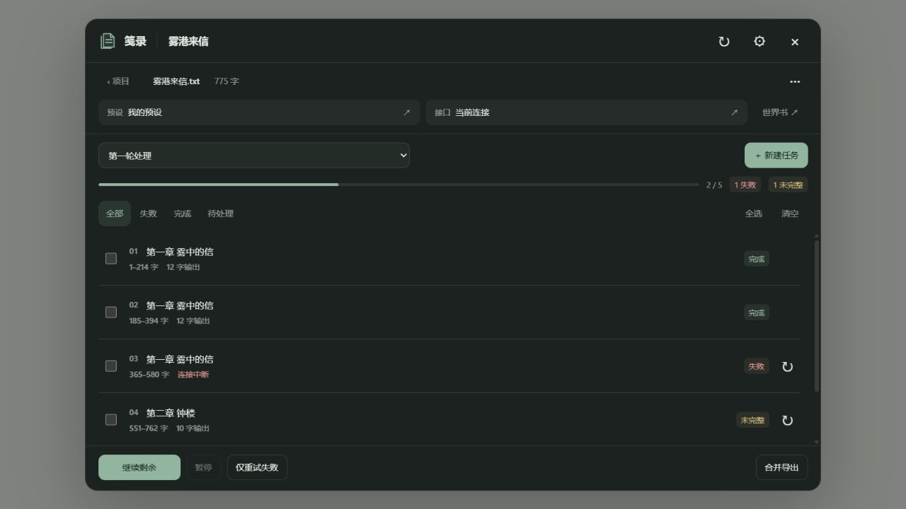

# 笺录 · 小说工作台

SillyTavern 扩展，版本 0.1.0。一部小说一个项目，使用酒馆当前的预设、世界书和 API 处理材料。

插件提供项目、原文、分块任务、请求快照、失败重试、输出编辑、合并和备份。剧情总结、人物提取、道具整理、查漏等处理要求和输出格式完全由用户自己的预设定义；没有内置的分类生成器或内容提示词。

## 安装

在酒馆的“扩展 → 安装扩展”中填写仓库地址：

```text
https://github.com/1842a-droid/ST-Jianlu
```

安装完成后刷新酒馆，在输入框旁的扩展菜单打开“笺录”。之后在 GitHub 修改源码并提交，在酒馆扩展管理中更新“笺录”，再刷新页面即可加载改动。

### 手动安装

解压安装包，把完整的 `ST-Jianlu` 文件夹放进酒馆目录：

```text
SillyTavern/
  public/scripts/extensions/third-party/ST-Jianlu/
    manifest.json
    index.js
    ...
```

也可以安装在酒馆用户目录的 `data/<用户名>/extensions/ST-Jianlu/`。选择其中一种位置即可，不要重复安装。放好后刷新酒馆，在输入框旁的扩展菜单打开“笺录”。本地 ZIP 不是 Git 仓库地址，不要把 ZIP 路径填到“安装扩展”的仓库地址框。

源码直接使用浏览器 ES modules，无须 npm install 或编译。修改 JS/CSS 后刷新酒馆即可生效。

## 使用

1. 在酒馆打开一个单角色对话，选择 **Chat Completion** API 和自己的处理预设。
2. 打开笺录，新建项目，导入 TXT/Markdown 小说或粘贴原文。
3. 新建任务，选择输入与范围，设置分块长度、重叠长度，生成任务计划。此步不调用模型。
4. 点击任意块，查看原文与当前提示词预览。预设、接口、世界书按钮会打开酒馆原生编辑入口。
5. 点击“继续剩余”，逐块保存结果。中间某块失败不影响其他块；“仅重试失败”和“继续剩余”分开操作。
6. 点击块详情编辑输出，或合并导出。已有任务结果也能作为新任务输入，因此合并、自检和二次处理同样由预设完成。

原文文件支持 UTF-8、带 BOM 的 UTF-16 和 GB18030。插件不设固定字数上限，实际容量取决于浏览器内存、酒馆服务器和模型上下文。超过 20 万字的整体原文/合并内容只显示前 20 万字预览，保存、处理、复制和导出使用完整文本。

## 预设与世界书

首版使用酒馆原生 Chat Completion 的 Prompt Manager 构建请求，沿用已启用条目的顺序、身份、插入位置和深度，并使用当前角色绑定及全局选择的世界书。扫描材料是当前原文块。

通常只需保留预设的 **Chat History** 条目：插件把当前块作为一条独立输入放在这个位置，不带入已有聊天记录，也不向聊天插入小说和处理结果。

如需自定原文位置，可在启用的预设/世界书条目内使用数据占位符：

| 占位符 | 内容 |
| --- | --- |
| `{{jl_source}}` | 当前完整输入块 |
| `{{jl_project}}` | 小说项目名称 |
| `{{jl_block}}` | 当前块的章节或片段标签 |
| `{{jl_index}}` | 当前块序号，从 1 开始 |
| `{{jl_total}}` | 本次任务总块数 |

这些占位符只填入数据，不添加处理指令。若原文因为 Chat History 被关闭、插槽缺失或上下文容量不足而未完整进入请求，任务会明确报错，避免发送缺失材料。

待处理的新块在执行前读取当前预设；修改预设后，后续块使用修改后的配置。已运行块保留原请求，普通重试使用其原提示词；“按当前预设重跑”会重新读取配置，保留上一版输出。重试时若 API/模型/连接地址与记录不同，会提示切回或重新准备该块，不会暗中改写酒馆连接。

提示词页区分“当前预览”和“实际请求”。实际记录标明捕获阶段；宿主后端仍可能按提供商要求转换消息格式。复杂第三方 EJS、酒馆助手脚本、变量框架和其他扩展的所有行为不属于首版的完整兼容承诺。

## 结果与恢复

- 输出按任意文本保存，不强制人物、道具、剧情等数据结构。
- 完成一块保存一块；普通继续会跳过完成块与失败块。
- 重试失败不会重做已完成块；有意重做完成块需要在详情中确认。
- 输出长度达到模型上限时标为“未完整”，已有文字保留，可查看、导出或重试。
- 暂停取消当前请求，迟到响应不会覆盖暂停状态。刷新或重新打开项目后，执行中的块恢复为暂停。
- 合并按块顺序拼接结果，不进行暗中的语义合并。需要去重、整合、校对或形成一个完整 JSON 时，将已有结果作为新任务输入，用自己的预设处理。
- `.json` 原样导出会检查整段文本是否是有效 JSON；不自动猜测字段或修补结构。

## 保存与跨设备

正文、任务、块输出和请求快照保存到**当前酒馆用户的服务器文件**，文件名均以 `jl-` 开头。正文版本不可变，改原文不会改变旧任务的输入。扩展设置只保存主题和字号，不携带整本小说或 API 密钥。

手机和电脑访问**同一酒馆服务、同一用户账户**时，点击刷新即可读取同一项目。不同酒馆实例之间使用项目备份导入导出。备份导入会创建新标识，不覆盖现有项目。

同一时刻请在一个页面执行、编辑同一项目。当前版本保证本页面内的写入串行，酒馆通用文件接口没有跨设备事务锁；不把同时在两端操作宣称为冲突自动合并。

## 外观与性能

统一项目工作台，默认 13px，可选 12–16px；跟随酒馆、纸白、墨色三种外观。列表分页，只加载当前项目元数据，块详情按需读取。没有持续轮询、向量数据库、框架运行时或常驻后台服务。

界面预览，使用示例数据：



[手机布局预览](dev/preview-mobile.png)

## 验证

见 `TESTING.md`。无需安装依赖：

```powershell
node --max-old-space-size=128 --test --test-concurrency=1 tests/*.test.mjs
```

参考：[ST-BaiBai-Book](https://github.com/baibai-git/ST-BaiBai-Book)、[SillyTavern 扩展接口](https://docs.sillytavern.app/for-contributors/writing-extensions/)、[Prompt Manager](https://docs.sillytavern.app/usage/prompts/prompt-manager/)。本扩展为独立实现，没有复制参考项目的专用提示词与分类处理模块。
